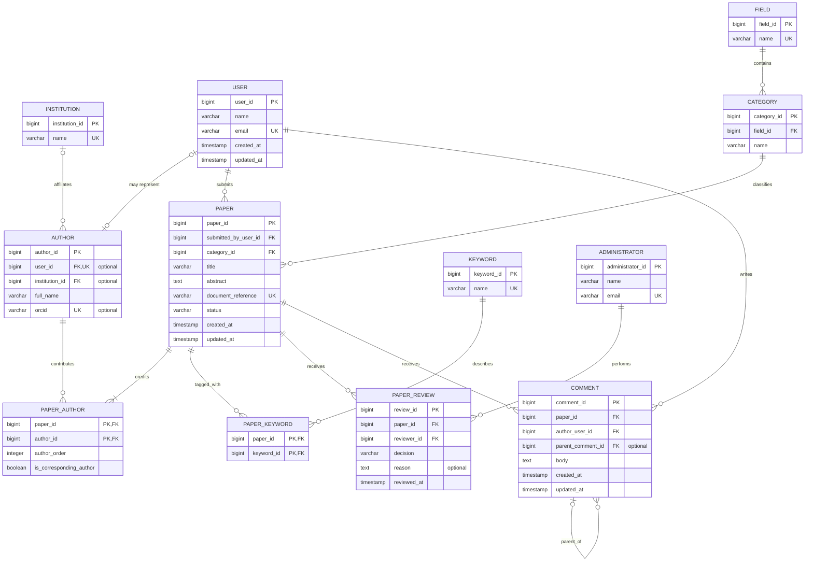

# Entity-Relationship Diagram

This diagram models the core research-publication domain selected for Portfolio 1 as an advanced database design for the case study.

## Main design decisions

- A user account submits a paper, but submission responsibility is separate from authorship.
- A paper must credit at least one author and may credit several authors.
- An author does not need a Nubian Research account. The optional link between `AUTHOR` and `USER` connects an author identity to an account when one exists.
- `PAPER_AUTHOR` resolves the many-to-many relationship between papers and authors while preserving author order and the corresponding-author designation.
- Every paper belongs to one category, and every category belongs to one research field.
- `PAPER_KEYWORD` resolves the many-to-many relationship between papers and keywords.
- `PAPER_REVIEW` records moderation decisions separately from a paper's current status, allowing review history to be retained.
- A comment belongs to one paper and one registered user. Its optional self-reference supports replies.

## Cardinality notation

| Symbol | Meaning |
| --- | --- |
| <code>&#124;&#124;</code> | Exactly one |
| <code>o&#124;</code> | Zero or one |
| <code>&#124;{</code> | One or many |
| <code>o{</code> | Zero or many |

The model deliberately excludes authentication sessions, donations, project-showcase submissions, email delivery, and deployment infrastructure, as seen on the live Nubian Research infrastructure. 
